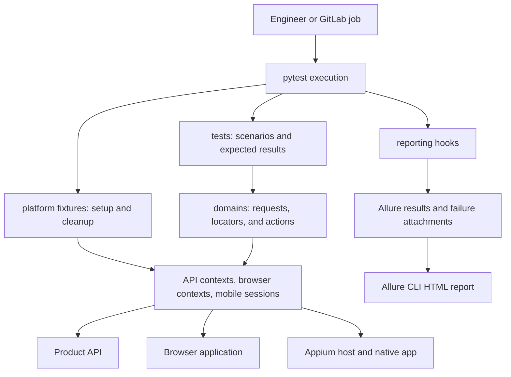
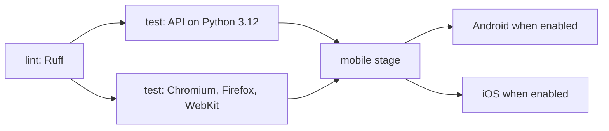

# Architectural solution and adoption rationale

**Project:** QA Automation Platform  
**Status:** Architecture recommendation grounded in the current repository  
**Audience:** Engineering leads, QA engineers, and platform engineers

## Recommendation

Adopt this project as a common harness for repeatable API, browser, and native mobile regression scenarios. Its strongest design choice is a clear division of responsibility: scenarios express expected behavior, domain objects perform application actions, and pytest fixtures manage execution resources. Reporting and CI provide a common way to run those scenarios and inspect the outcome.

This approach fits a team that releases an API and customer applications repeatedly and needs consistent evidence across those surfaces. It provides a practical foundation for expanding automation without building a separate execution framework for each platform.

Adoption should begin with a small set of real product journeys and measured execution results. The repository currently demonstrates three API cases, three browser cases per selected engine, and one native mobile case. Those examples establish the implementation pattern; they do not establish coverage of a production product or prove a financial return.

## Why the team needs a shared approach

As regression scenarios grow, the recurring cost extends beyond writing assertions. Engineers must also prepare sessions, select targets, manage credentials, close resources, reproduce failures, and provide evidence that another person can interpret. Repeating those responsibilities in individual scripts makes their behavior harder to maintain consistently.

A common harness addresses five concrete engineering needs:

- **Maintain application changes in a known place.** Request paths and UI locators live in domain objects. A locator change can be handled there while scenario assertions continue to describe the intended behavior.
- **Make resource ownership explicit.** Fixtures create and close contexts and drivers. Scenario authors can reuse a supported lifecycle instead of implementing their own cleanup in every flow.
- **Produce comparable failure evidence.** Shared reporting hooks attach case IDs, runtime metadata, and available failure screenshots. This gives engineers a consistent starting point for diagnosis.
- **Select the right scope of feedback.** Markers, paths, and case IDs allow API, browser, and mobile checks to run independently. A developer can select a focused scenario, while CI can select broader coverage.
- **Keep execution rules reviewable.** Browser engines, mobile prerequisites, artifact paths, and job stages are expressed in repository configuration and shared code.

These are mechanisms the implementation supplies. Reduced maintenance effort, faster diagnosis, and better release confidence are expected benefits to verify during adoption, rather than guarantees attached to the framework.

## Solution structure

The solution is a Python test application composed through pytest. It runs locally or inside CI jobs and communicates with external APIs, websites, and Appium servers. It does not require a separately deployed orchestration service.

### Scenarios own intent and outcomes

Files under `tests/<platform>/<domain>/` describe what a user or API consumer should be able to do and what result is expected. They own platform/domain markers, case IDs, assertions, and Allure steps.

For example, the [browser cart scenario](../tests/browser/shop/test_cart.py) signs in, adds a product, and verifies the displayed cart item. The test states the expected item name, while the browser domain classes hold selectors and navigation actions. The [API scenario](../tests/api/shop/test_products.py) similarly owns response assertions while `ProductsPage` owns the product request path.

This boundary keeps the scenario readable during product review and gives implementation details an explicit maintenance location.

### Domain objects own application interaction

`src/domains/<platform>/<domain>/` contains small concrete objects:

- [`ProductsPage`](../src/domains/api/shop/products_page.py) owns the API base URL and product request methods.
- [`LoginPage`](../src/domains/browser/shop/login_page.py), [`InventoryPage`](../src/domains/browser/shop/inventory_page.py), and [`CartPage`](../src/domains/browser/shop/cart_page.py) own browser navigation, login actions, and locators.
- [`ShopPage`](../src/domains/mobile/shop/shop_page.py) owns native app locators, cart actions, and explicit waits, with Android and iOS locator choices.

Here, `domains` names application-specific automation code. It does not imply a business domain model or a common abstraction across API, browser, and native UI protocols. These objects receive an existing request context, page, or driver and operate through that library's API.

### Platform fixtures own lifecycle

[`tests/conftest.py`](../tests/conftest.py) loads [`platform_plugin.py`](../src/platform/platform_plugin.py), which registers the reporting plugin and provides shared execution behavior.

API request contexts, browser contexts/pages, and mobile driver sessions have function scope. Their lifecycle is managed by fixtures. Mobile settings, capabilities, and the Appium server fixture have session scope and are requested when needed. Browser context cleanup is delegated through pytest-playwright's context factory.

Appium ownership is particularly useful for local and CI parity. The fixture reuses a ready server, or starts an unreachable local HTTP loopback server when the Appium executable is available. It stops only a process it created. Remote servers, device provisioning, and platform tooling remain the responsibility of the Appium host.

Fresh contexts and sessions reduce shared client state between scenarios. They do not reset remote application data or guarantee an empty device/app state; scenario data and native app reset behavior require explicit ownership.

## Why these technology choices fit

### Pytest provides the composition mechanism

Pytest already supplies discovery, parametrization, markers, fixtures, hooks, and exit status. Using those capabilities directly gives the project one lifecycle model across all three platforms. Teams can extend a fixture or add a scenario using the same mechanism as the existing code.

A custom runner would introduce another layer of selection, execution, cleanup, and error propagation to maintain. The current project has no demonstrated need for that additional layer.

### Playwright covers API and browser interaction

The implementation uses Playwright's synchronous request context for HTTP scenarios and its browser APIs for web journeys. This shares one Python dependency across those two interaction types and lets browser scenarios use Playwright's locator and waiting behavior directly.

The cost is a shared dependency lifecycle: API and browser automation both depend on the pinned Playwright package. Browser execution also depends on matching browser binaries and CI images. For the current small request layer, this is a coherent choice. A separate HTTP library would be justified only by concrete requirements that the existing request API does not meet.

### Appium preserves native platform support

Native Android and iOS interaction uses Appium and the appropriate driver: UiAutomator2 or XCUITest. The pytest process can connect to a local or remote Appium host, allowing mobile platform tools to live on a suitable machine.

Browser automation and native automation retain their own APIs and locator strategies. This makes platform differences visible where they must be maintained. Sharing a scenario structure does not require pretending that a browser page and a native app have identical interaction semantics.

### Domain classes retain target configuration

API and browser target URLs are reviewed source constants: `ProductsPage.BASE_URL` and `LoginPage.BASE_URL`. Request paths, locators, and target identity therefore remain close to each other. Runtime settings such as browser engine, recording options, mobile device, and Appium endpoint come from pytest options or the environment. Credentials are supplied explicitly or through environment variables.

This boundary follows the project's current configuration choice. It means changing the API or browser host requires a code change. Running an unchanged checkout against several deployment URLs through environment variables is not supported by this design. If that becomes a requirement, revisit target selection as an explicit architecture change while preserving the domain objects' responsibility for paths and actions.

### Shared reporting makes results easier to inspect

[`reporting_plugin.py`](../src/platform/reporting_plugin.py) adds Allure IDs/tags, platform features, mobile parameters, and runtime versions. On setup or call failure, it attempts a screenshot when a browser page or mobile driver is available. Capture uses a bounded timeout, and a capture error preserves the original test failure.

Allure results remain separate from report rendering. Pytest writes results; the Node.js Allure CLI generates or displays an HTML report. API and browser pytest execution does not require the report renderer to be running.

Case IDs support selection and traceability inside the repository, but uniqueness remains a review convention. There is no implemented integration that synchronizes those IDs with an external test-management system.

## Execution and scaling model

[`run_tests.sh`](../run_tests.sh) provides a local entry point that loads `.env`, selects the interpreter, combines marker filters, and writes results for a selected tag. Direct pytest remains available for explicit commands and CI.

The current GitLab configuration uses three stages:

The API job uses a configurable Python-version matrix whose current list contains only 3.12. The browser job creates separate jobs for Chromium, Firefox, and WebKit using the pinned Playwright image. These jobs can execute concurrently when runners are available. Browser Python versions come from that image; the configuration does not create a Python-by-browser cross-product.

This provides an initial scaling boundary at the job level, with separate workspaces and artifacts. Pytest does not currently use xdist workers or configured retries. Additional parallelism should follow evidence of a feedback-time bottleneck and available isolated targets.

Mobile capacity depends on devices, Appium endpoints, and runner availability. Android and iOS jobs are opt-in, and the repository has no device lock across pipelines. Assign distinct devices or serialize access through runner scheduling before increasing mobile concurrency.

Independent runs must also isolate mutable application data and output files. Browser/API contexts do not provide backend data isolation. Local runs sharing a checkout can overwrite result directories, HAR files, or the Appium log; separate workspaces and result paths are the safer operating model for concurrent local execution.

## Operational responsibilities

The architecture can centralize test execution rules, but adoption still requires named owners for its external dependencies:

- **Product engineers and QA engineers** own scenario relevance, expected results, domain actions, selectors, and disposable test data.
- **Automation maintainers** own shared fixtures, reporting behavior, dependency alignment, case-ID conventions, and the runnable documentation.
- **Platform or runner owners** provide CI capacity, Appium services, mobile drivers, SDK/Xcode, device preparation, and network access.
- **The team owning the release process** decides which selections block a release and who responds when a gate fails.

Credentials belong in ignored local configuration or protected CI variables. Reports and recordings may contain page content, cookies, or test data and need controlled access and retention. The current GitLab jobs retain artifacts for seven days. They publish individual results and reports; a combined Allure report and persistent CI history are not implemented.

Mobile environments must match the app build. An iOS simulator requires a simulator build; the current iOS CI IPA targets a physical device and needs the corresponding device/signing preparation. These prerequisites affect whether a mobile failure represents a product defect or an environment problem.

## Why use this project instead of separate scripts

Separate scripts can be suitable for a one-off probe. Their maintenance cost grows when many scenarios independently implement login, session ownership, result paths, and diagnostics. This project gives those shared responsibilities a common implementation while leaving the scenario and application interaction code concrete.

A universal custom framework would move in the other direction: it would add interfaces, adapters, and orchestration that the current examples do not require. The present design uses pytest, Playwright, and Appium directly and concentrates custom code on the project's actual needs.

Manual exploratory checks remain valuable for unfamiliar behavior and new product changes. This harness is useful for known, repeatable expectations that the team needs to check consistently across releases. Its adoption case is strongest when the same critical journeys recur often enough that repeatable execution and reusable diagnostics justify maintaining them.

## Adoption plan and decision criteria

### Establish a product pilot

Choose a small set of important API expectations and customer journeys. Adapt the existing domain classes and assertions to real test environments. Assign scenario owners, provide disposable accounts/data, and confirm that a new engineer can run the selected scenarios using the documented setup.

During the pilot, distinguish assertion failures from target availability, configuration, and infrastructure failures. Confirm cleanup behavior and the usefulness of generated evidence before treating the suite as a release gate.

### Expand execution coverage deliberately

Run the selected browser journeys across the required engine matrix. Enable mobile only after devices, Appium endpoints, app builds, and runner ownership are ready. Choose the runtime list based on the team's support requirements and compatible dependencies.

Promote stable, relevant selections into required CI gates. A failed job should have an owner and a clear response path. Adding blanket retries would obscure the distinction between a stable signal and an intermittent one; the existing configuration leaves failures visible.

### Measure whether adoption is worthwhile

Use a baseline and an agreed observation period to assess these outcomes:

- **Feedback time:** elapsed time from requesting a selection to receiving its result, including CI queue time.
- **Failure investigation time:** time needed to identify a failed run's cause and responsible owner.
- **Repeatability:** unexplained pass/fail changes for the same revision, inputs, and controlled target state.
- **Maintenance effort:** effort to update the affected scenarios after a known API or UI change.
- **Critical journey coverage:** the agreed release expectations represented by maintained scenarios, with named owners.

These are proposed adoption measures. The repository produces case outcomes, timings, artifacts, and CI job results, but does not calculate all these measures or supply an organizational metrics dashboard. Agree success thresholds with the pilot owners instead of assuming a universal percentage or speedup.

Continue expanding the harness when it delivers a useful, repeatable signal at an acceptable maintenance cost. If failures remain dominated by shared data, unreliable demo environments, or device contention, resolve those operating conditions before expanding the scenario count.

## Implementation evidence and scope of this recommendation

This proposal is grounded in the checked-in [scenario suites](../tests/), [domain objects](../src/domains/), [pytest plugin](../src/platform/platform_plugin.py), [reporting plugin](../src/platform/reporting_plugin.py), [mobile options](../src/platform/mobile/options.py), [pytest configuration](../pytest.ini), [GitLab pipeline](../.gitlab-ci.yml), and [Allure configuration](../allurerc.json).

The architecture was reviewed from source and configuration. This document does not claim a successful execution of every browser/device combination, a validated live GitLab pipeline, or measured savings. Use the [technical guide](README.md) for setup and operational commands, and collect pilot evidence before making those claims.
