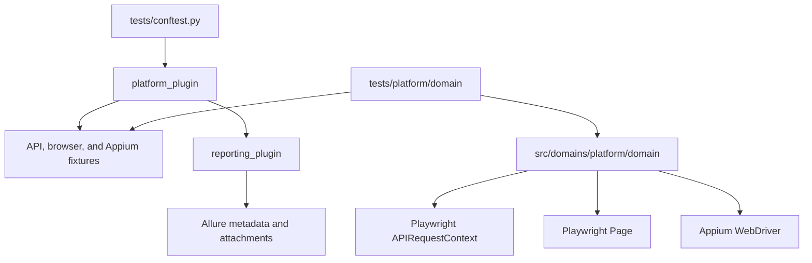
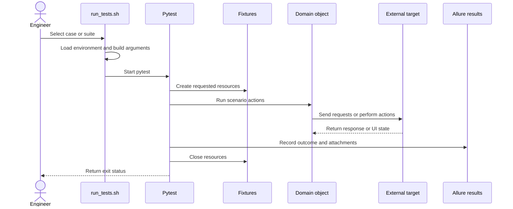
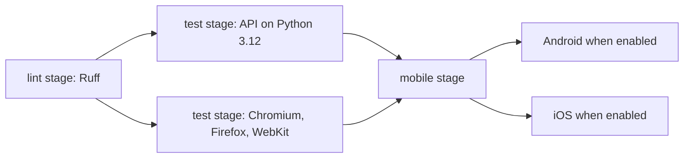
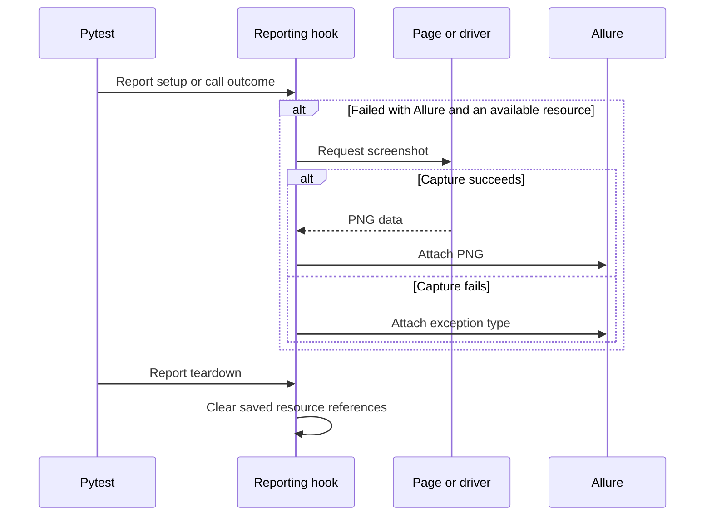

# QA Automation Platform — Technical Guide

This guide follows the code and configuration in this repository. For installation and your first run, start with the [root README](../README.md).

## Contents

- [1. System overview](#1-system-overview)
- [2. Software architecture](#2-software-architecture)
- [3. Execution lifecycle](#3-execution-lifecycle)
- [4. Repository and module reference](#4-repository-and-module-reference)
- [5. Installation and environment setup](#5-installation-and-environment-setup)
- [6. Configuration reference](#6-configuration-reference)
- [7. Test development guide](#7-test-development-guide)
- [8. Integrations and CI/CD](#8-integrations-and-cicd)
- [9. Logging, reporting, and troubleshooting](#9-logging-reporting-and-troubleshooting)
- [10. Security and reliability](#10-security-and-reliability)
- [11. Extension and maintenance](#11-extension-and-maintenance)
- [12. Portability and execution topologies](#12-portability-and-execution-topologies)

## 1. System overview

The project runs three example suites through pytest:

- **API:** `ProductsPage` sends GET requests to Fake Store API. Three parametrized cases check product IDs, titles, and expected prices (`TEST-01`–`TEST-03`).
- **Browser:** Playwright signs in to SauceDemo and checks three products in the cart (`TEST-04`–`TEST-06`).
- **Native mobile:** Appium adds a product to the cart in Sauce Labs My Demo App and checks the item count (`TEST-07`). The page object has Android and iOS locators.

With one browser engine selected, these definitions produce seven scenario cases. Selecting multiple browser engines repeats the browser cases for each engine. The demo services, app builds, Appium server, and devices are external to this repository.

A **case ID** is the value of `@pytest.mark.test_case(id="TEST-…")`. A **run tag** is the wrapper's first argument, such as `TEST-04` or `all`. A **browser profile** selects Playwright emulation; `MOBILE_PLATFORM` selects a native Appium platform. **Allure results** are raw files that the Allure CLI later turns into an HTML report.

## 2. Software architecture

The project has three working boundaries:

- `tests/` defines scenarios, markers, Allure steps, and expected results.
- `src/domains/<platform>/<domain>/` contains API request methods and browser/mobile page objects.
- `src/platform/` configures pytest and owns resource setup, cleanup, and reporting hooks.

`tests/conftest.py` loads `platform_plugin`, which registers `reporting_plugin`. Pytest's configured import paths are `src` and `src/platform`, so imports use `domains.…`, `config.settings`, and `mobile.options`. Run documented commands from the repository root.



`ProductsPage` owns the API URL and product paths. `LoginPage` owns the browser URL and login actions; the other browser page objects own inventory/cart locators and actions. `ShopPage` owns native app locators and waits. Each object receives an existing context, page, or driver; fixtures retain ownership of the underlying resource.

## 3. Execution lifecycle

### Entry points and selection

```sh
# A case ID, with an additional platform filter
./run_tests.sh TEST-04 -m browser

# A whole suite or a name filter
./run_tests.sh all -m api
./run_tests.sh all -m browser -k cart

# Select a browser and slow visible actions
./run_tests.sh TEST-04 --browser chromium --headed --slowmo=500
```

The wrapper changes to the repository root, sources `.env` when present, and chooses `PYTHON`, `.venv/bin/python`, `python`, or `python3`, in that order. Its first argument defaults to `all`. A case tag selects `test_case(id='…')`; supplied `-m` expressions are combined with it using `and`. A tag with no matching case returns pytest's no-tests status.

The wrapper supplies `--alluredir=reports/<lowercase-tag>/allure-results --clean-alluredir` and returns pytest's exit status. Direct pytest uses the defaults in [pytest.ini](../pytest.ini), including `reports/allure-results/` and `reports/playwright/`.



### Resource ownership

- `settings`, browser `device` selection, mobile options, and the Appium server fixture have **session scope**. Mobile options and Appium are requested only by mobile runs.
- `api_request_context` has **function scope**, sends `Accept: application/json`, and disposes its context in `finally`.
- Browser `context` and `page` have **function scope**. The project enables optional HAR recording through pytest-playwright's `new_context` fixture, which manages cleanup.
- `mobile_driver` has **function scope** and calls `quit()` in `finally`.
- Appium cleanup stops only the server process created by the fixture. A pre-existing server stays running.

The reporting plugin also loads mobile settings for mobile labels. Settings do not validate the app path until mobile options are built.

## 4. Repository and module reference

```text
src/
├── domains/
│   ├── api/shop/products_page.py
│   ├── browser/shop/
│   │   ├── login_page.py
│   │   ├── inventory_page.py
│   │   └── cart_page.py
│   └── mobile/shop/shop_page.py
└── platform/
    ├── config/settings.py
    ├── mobile/options.py
    ├── platform_plugin.py
    └── reporting_plugin.py
tests/
├── conftest.py
├── api/shop/test_products.py
├── browser/shop/test_cart.py
└── mobile/shop/test_my_demo_app_cart.py
```

The main files to change are:

- [`products_page.py`](../src/domains/api/shop/products_page.py): API base URL and product request methods.
- [`login_page.py`](../src/domains/browser/shop/login_page.py): browser target URL, credential inputs, and login actions.
- [`inventory_page.py`](../src/domains/browser/shop/inventory_page.py) and [`cart_page.py`](../src/domains/browser/shop/cart_page.py): inventory/cart locators and navigation.
- [`shop_page.py`](../src/domains/mobile/shop/shop_page.py): Android/iOS locators, cart actions, and 10-second explicit waits.
- [`settings.py`](../src/platform/config/settings.py) and [`options.py`](../src/platform/mobile/options.py): mobile environment values and Appium capabilities.
- [`platform_plugin.py`](../src/platform/platform_plugin.py): browser defaults, profiles, HAR, API context, and Appium lifecycle.
- [`reporting_plugin.py`](../src/platform/reporting_plugin.py): environment metadata, case IDs, feature labels, mobile parameters, and failure screenshots.

Project configuration lives in [pytest.ini](../pytest.ini), [requirements.txt](../requirements.txt), [pyproject.toml](../pyproject.toml), and [pyrightconfig.json](../pyrightconfig.json). `pyproject.toml` configures Ruff; the project has no Python build declaration. Pyright import paths are supplied, but no Pyright dependency or CI job is declared.

Execution and report entry points are [run_tests.sh](../run_tests.sh), [package.json](../package.json), [allurerc.json](../allurerc.json), and [allure.watch.mjs](../allure.watch.mjs). CI is defined in [.gitlab-ci.yml](../.gitlab-ci.yml).

## 5. Installation and environment setup

### Python and browser setup

Use Python **3.12** to match the current CI configuration and Ruff target:

```sh
python3 -m venv .venv
source .venv/bin/activate
python -m pip install -r requirements.txt
python -m playwright install chromium
cp .env.example .env
```

Install Firefox or WebKit with `python -m playwright install firefox` or `python -m playwright install webkit`. Browser runs need the matching binary; API runs use Playwright's request context without launching a browser.

Edit `.env` for browser execution and mobile settings. Browser login requires `WEB_USERNAME` and `WEB_PASSWORD`, which are intentionally omitted from the example file. API and browser URLs are set in `ProductsPage.BASE_URL` and `LoginPage.BASE_URL`.

`run_tests.sh` sources `.env` as shell syntax and exports its values. Values assigned there can overwrite variables supplied before invoking the wrapper. For direct pytest, export the environment yourself:

```sh
set -a
source .env
set +a
python -m pytest tests/api/shop -m api \
  --alluredir=reports/api/allure-results --clean-alluredir
```

Node.js/npm is needed for the Allure CLI and for local Appium installation. Install report dependencies with `npm ci`. The project does not declare a Node.js engine version. Connecting to an already-running remote Appium server needs no local Appium installation.

### Android setup

On the Appium host, install Appium and UiAutomator2, and make the Android SDK tools available:

```sh
npm install --global appium
appium driver install uiautomator2
emulator -avd Pixel_8_Pro_API_35
```

Keep the emulator running. The example environment selects that device name, the Sauce Labs Android 2.3.0 APK URL, and its startup activity. Appium must inherit `ANDROID_HOME` or `ANDROID_SDK_ROOT` and the required SDK tool paths. `MOBILE_DEVICE_NAME` does not start an AVD.

Run `./run_tests.sh TEST-07` from the project root. The fixture can start a missing local Appium server automatically. To manage it yourself, run `appium` on the Appium host before starting pytest.

### iOS setup

The Appium host must run macOS with Xcode and the XCUITest driver:

```sh
npm install --global appium
appium driver install xcuitest
```

For an iOS simulator, update these values in `.env` and start the selected simulator:

```sh
MOBILE_PLATFORM=iOS
MOBILE_DEVICE_NAME="iPhone 16 Pro Max"
MOBILE_APP_PATH=https://github.com/saucelabs/my-demo-app-ios/releases/download/2.3.0/SauceLabs-Demo-App.Simulator.zip
```

Use a simulator build such as the `.Simulator.zip` above. The `.ipa` URL in the example file and iOS CI job targets a physical device; it cannot run in Simulator. For a physical iPhone, use a compatible signed IPA and set `MOBILE_UDID` to the device identifier. Device preparation and signing belong on the Appium host.

### Local and remote Appium

`APPIUM_SERVER_URL` defaults to `http://127.0.0.1:4723`. The fixture probes `<base-url>/status` with a two-second request timeout. It reuses a server only when the response contains `value.ready: true`.

If the server is unreachable, automatic startup is allowed only for a plain HTTP loopback address. The fixture uses the URL's host, port, and optional base path, writes `reports/appium.log`, and waits up to 30 seconds. A malformed or unready status response fails setup. Remote and HTTPS servers must already be ready.

App paths are interpreted by the Appium host: a local file must exist there, and a release URL must be retrievable from there. Automatic local process cleanup uses POSIX process groups; use a ready external server when that process model is unavailable.

## 6. Configuration reference

### API and browser target URLs

Target URLs are class constants in `src/domains/`:

- [`ProductsPage.BASE_URL`](../src/domains/api/shop/products_page.py): `https://fakestoreapi.com`. Product methods build their request URLs from this constant and the product path.
- [`LoginPage.BASE_URL`](../src/domains/browser/shop/login_page.py): `https://www.saucedemo.com`. `open()` navigates directly to this constant.

To change a target, edit the corresponding domain class and check its request paths, locators, and scenario expectations. The shared fixtures create and clean up resources; `Settings.from_env()` handles mobile configuration.

### Where values belong

- **API:** change `ProductsPage.BASE_URL` and request methods in `src/domains/api/shop/`. The request fixture supplies lifecycle and headers.
- **Browser target and login:** change `LoginPage.BASE_URL` in `src/domains/browser/shop/` to select the website. `login()` accepts explicit credentials or reads `WEB_USERNAME` and `WEB_PASSWORD` when called; missing values raise `ValueError`.
- **Browser execution:** pytest options and environment defaults select engines, emulation, recording, and visibility.
- **Mobile:** `Settings.from_env()` reads mobile values once per session; `build_mobile_options()` validates the app path/platform and creates UiAutomator2 or XCUITest options.

### Environment variables

Defaults below describe the code. The sample file supplies some different values, including a visible browser, a named Android AVD, and an app URL.

- `WEB_USERNAME`, `WEB_PASSWORD`: no defaults. Required for login unless passed directly to `login()`.
- `BROWSER_PROFILE`: defaults to `desktop`. Shortcuts are `mobile` → Pixel 7, `iphone` → iPhone 13, and `ipad` → iPad (gen 5). Exact Playwright device names are accepted; unknown names fail setup.
- `PLAYWRIGHT_BROWSER`: `chromium`, `firefox`, or `webkit`. The sample and CI select Chromium; otherwise pytest-playwright supplies its default.
- `PLAYWRIGHT_HEADED`: `on` or `off`. The sample sets `on`; CI sets `off`.
- `PLAYWRIGHT_TRACING`, `PLAYWRIGHT_VIDEO`: `on`, `off`, or `retain-on-failure`. The sample uses `retain-on-failure`; CI uses `on`.
- `PLAYWRIGHT_HAR`: `on` or `off`, default `off`. Records one HAR per browser test when enabled. CI sets `on`.
- `PLAYWRIGHT_HAR_DIR`: defaults to `reports/playwright/har`.
- `APPIUM_SERVER_URL`: defaults to `http://127.0.0.1:4723`.
- `MOBILE_PLATFORM`: case-insensitive `Android` or `iOS`, default `Android`.
- `MOBILE_DEVICE_NAME`: defaults to `Android Emulator`; the sample uses `Pixel_8_Pro_API_35`.
- `MOBILE_UDID`: optional device identifier, passed to Appium when nonempty.
- `MOBILE_APP_PATH`: no code default. Required for mobile setup; accepts an app URL or an Appium-host file path. The sample supplies an Android APK URL.
- `MOBILE_APP_WAIT_ACTIVITY`: optional Android startup activity. The sample supplies My Demo App's main activity; iOS ignores it.
- `PYTEST_ADDOPTS`: standard pytest additional arguments.
- `PYTHON`: optional interpreter override used by `run_tests.sh`.

### Precedence and validation

Pytest combines `pytest.ini`, `PYTEST_ADDOPTS`, and invocation arguments. The project applies browser, headed, trace, and video environment defaults only if the corresponding long option is absent from those argument sources. Explicit `--device` takes precedence over `BROWSER_PROFILE`.

For example, `--browser firefox` overrides the sample's `PLAYWRIGHT_BROWSER=chromium`. Multiple `--browser` options select multiple engines. To run without a visible window, set `PLAYWRIGHT_HEADED=off` in `.env` or the environment used for direct pytest.

The plugin validates its browser defaults, HAR value, browser profile, Appium URL, mobile platform, and required app path. Target URL safety, credential validity, and device availability still depend on the selected target and host.

## 7. Test development guide

Create suites under `tests/<platform>/<domain>/` and reusable request/UI actions under `src/domains/<platform>/<domain>/`. Keep resource creation in fixtures. Tests should describe the scenario and assert the outcome.

Use the platform/domain markers declared in `pytest.ini`, plus a unique case ID when the wrapper must select the case. The reporting plugin copies IDs to Allure IDs and tags; uniqueness is a project convention. `smoke` is registered but unused by the current scenarios.

### API example

Follow [test_products.py](../tests/api/shop/test_products.py):

```python
import pytest
from playwright.sync_api import APIRequestContext

from domains.api.shop.products_page import ProductsPage


@pytest.mark.api
@pytest.mark.shop
@pytest.mark.test_case(id="TEST-08")
def test_product_is_returned(api_request_context: APIRequestContext) -> None:
    response = ProductsPage(api_request_context).get_product(1)
    assert response.status == 200
    product = response.json()
    assert product["id"] == 1
    assert product["title"]
```

Extend `ProductsPage` for new request paths. The fixture supplies `Accept: application/json`; authentication, expected data, and response assertions belong with the relevant scenario/domain behavior. Request timeout behavior comes from Playwright unless a request method overrides it.

### Browser and mobile examples

The [browser cart suite](../tests/browser/shop/test_cart.py) uses `page`, constructs `LoginPage`, then navigates through `InventoryPage` and `CartPage`. Use Playwright `expect` for browser assertions that need to wait for UI state.

The [mobile cart scenario](../tests/mobile/shop/test_my_demo_app_cart.py) uses `mobile_driver` and `settings`, then constructs `ShopPage(driver, settings.mobile_platform)`. Keep Android resource IDs and iOS accessibility IDs in the domain object. Its current waits are 10 seconds.

For parametrized scenarios, put the case marker on each `pytest.param`. The optional `id=` display label is separate from `test_case(id="…")`.

### Recording a starting point

For browser flows, run Playwright Codegen against the URL in `LoginPage.BASE_URL`. For the current SauceDemo target:

```sh
python -m playwright codegen --target=python-pytest https://www.saucedemo.com
```

Move useful locators/actions into the matching domain object and adapt the generated scenario to the existing `page` fixture. Remove captured credentials and session data.

For native flows, use Appium Inspector with the same server URL, platform, device, and app capabilities as the fixture. Record Python actions, then move them into the mobile domain object. Keep the existing `mobile_driver` fixture in charge of sessions and replace fixed delays with explicit waits.

## 8. Integrations and CI/CD

Python packages are pinned in [requirements.txt](../requirements.txt): pytest 9.1.1, Playwright 1.64.0, pytest-playwright 0.10.0, Appium Python Client 6.0.7, allure-pytest 2.16.2, pytest-html 4.2.0, and Ruff 0.17.0. The Allure CLI is pinned to 3.21.0 in [package.json](../package.json) and its lockfile.

### Jobs and runtime matrix

The current [.gitlab-ci.yml](../.gitlab-ci.yml) defines:

- **Lint:** Ruff on `python:3.12-slim`.
- **API:** a `PYTHON_VERSION` matrix currently containing only `"3.12"`, using `python:${PYTHON_VERSION}-slim`.
- **Browser:** a `BROWSER_ENGINE` matrix containing `chromium`, `firefox`, and `webkit`, using the Playwright `v1.64.0-noble` image. Each job passes its engine explicitly with `--browser`.
- **Android:** opt-in with `RUN_ANDROID=true`, on a runner tagged `android`.
- **iOS:** opt-in with `RUN_IOS=true`, on a runner tagged `macos`. Its app URL is a physical-device IPA.

To expand API runtime coverage, edit the `PYTHON_VERSION` list in the API job and check that the pinned dependencies support each version. Edit `BROWSER_ENGINE` to change browser coverage. Browser jobs use the Python runtime included in the Playwright image; the matrices do not form a Python-by-browser cross-product.



### Runner configuration and parallel runs

API and browser jobs share the `test` stage and may run concurrently when runners are available. Enabled Android and iOS jobs share the later `mobile` stage. Pytest itself runs without xdist workers or configured retries.

Browser jobs need `WEB_USERNAME` and `WEB_PASSWORD` as CI/CD variables. Mobile runners must already have Appium, the appropriate driver, Android SDK or Xcode, and an available device. Set `APPIUM_SERVER_URL`, `MOBILE_DEVICE_NAME`, and `MOBILE_UDID` as needed for that runner. The jobs install Python dependencies but do not provision mobile tooling or devices.

Each CI job writes into its own workspace. Independent local runs need distinct Allure, Playwright, and HAR directories to avoid clearing or overwriting files. For mobile concurrency, assign separate devices and Appium endpoints; there is no device lock across pipelines. Shared remote accounts/data also need isolation.

### CI artifacts

Test jobs request JUnit XML, self-contained pytest-html reports, raw Allure results, and the applicable browser/mobile artifacts. GitLab uploads `reports/` with `when: always` and a seven-day expiry. There is no job to merge results, generate a combined Allure HTML report, or preserve Allure history between pipelines.

## 9. Logging, reporting, and troubleshooting

### Allure commands and outputs

```sh
npm ci

# Run one case with the Allure CLI wrapper
npm run test:report -- TEST-04

# Build a report from the configured result directories
npm run report
npm run report:open

# Watch results while checks run in another terminal
npm run report:watch
```

`allurerc.json` reads `reports/allure-results` and `reports/*/allure-results`. The static report goes to `reports/allure-report`; the watcher uses `reports/allure-live`, disables history append, and discovers result directories. Both viewing commands bind to `127.0.0.1`. Static history is configured at `reports/allure-history.jsonl`, with a limit of 30 entries.

Each wrapper run clears the results directory for its tag. Direct pytest clears its default Allure directory unless you choose another `--alluredir`. Generate reports only from result directories you intend to include; existing directories can contribute earlier results.

The reporting plugin writes Python, OS, pytest, Playwright, and Appium client versions to `environment.properties`. Case markers become Allure IDs/tags; platform markers become API, Browser, or Mobile features. Mobile runs also include platform/device parameters. Test code supplies titles, stories, and steps; the API scenario attaches the request path and HTTP status.

### Browser recordings and failure evidence

Browser traces and video follow pytest-playwright options; their default output root is `reports/playwright`. Optional HAR files use `PLAYWRIGHT_HAR_DIR`, a sanitized test name, and a node-ID hash. Inspect a retained browser trace with:

```sh
python -m playwright show-trace path/to/trace.zip
```

For setup or call failures, the hook tries a screenshot only when Allure output is enabled and a browser page or mobile driver was created successfully. Browser capture uses a five-second timeout; mobile capture temporarily uses a five-second command timeout. Capture errors add the exception type as a text attachment and preserve the original failure. Teardown clears saved resource references.



When the fixture starts Appium locally, server output goes to `reports/appium.log`. A subsequent local start overwrites that log. Pytest output is otherwise the normal console output; the project has no separate application logger.

### Troubleshooting

- **No tests match a tag:** check the exact case ID and `test_case` marker, plus any `-m` or `-k` filter. Case selection is case-sensitive.
- **Browser login fails before entering credentials:** configure `WEB_USERNAME` and `WEB_PASSWORD`, or pass both to `LoginPage.login()`.
- **Browser opens the wrong website:** check `LoginPage.BASE_URL` in the browser domain class.
- **Browser executable is missing:** install the selected engine with `python -m playwright install chromium`, `firefox`, or `webkit`.
- **Browser opens on a headless runner:** check `PLAYWRIGHT_HEADED` and whether `.env` overwrote an exported value. CI sets it to `off`.
- **Browser/profile/HAR setting is rejected:** use the accepted values in [configuration](#6-configuration-reference). Exact Playwright device names must exist in the installed version.
- **API cannot connect or price assertions change:** inspect `ProductsPage.BASE_URL`, network access, target availability, and the demo product data.
- **Mobile setup reports a missing app:** set `MOBILE_APP_PATH` to an app visible to the Appium host.
- **Appium is unreachable or exits:** check the server URL, Appium executable, drivers, SDK environment, and `reports/appium.log`. Remote/HTTPS servers must be started separately.
- **iOS app does not install:** match Simulator with a simulator build and a physical device with a compatible IPA. Check UDID and signing requirements on the Appium host.
- **Results disappear or mix with another run:** check the selected output directories and `--clean-alluredir`. Use separate paths for concurrent runs.
- **CI job stays pending:** check runner availability, tags, opt-in variables, and the required host tooling.

## 10. Security and reliability

`.env`, reports, caches, virtual environments, `node_modules`, and Graphify output are ignored by Git. Keep login credentials in local ignored configuration or protected CI variables. The sample file contains public app/website URLs and no login credentials.

Screenshots, HAR, traces, video, pytest output, and Appium logs can contain test data, cookies, or request details. Protect artifact access and use disposable accounts. The reporting code does not redact these files; the explicit API attachment includes only the path and status.

Use trusted Appium endpoints and secure remote access on the host. The fixture validates URL syntax and limits automatic startup to local HTTP, but it does not configure server authentication or TLS. API and browser target URLs are application-specific and have no allowlist.

Contexts and driver sessions are cleaned up by fixtures, and screenshot failures preserve the original test failure. External demo availability and state still affect outcomes. Avoid sharing one device, account, output directory, or mutable data set between independent runs without coordination.

## 11. Extension and maintenance

### Add or change a scenario

1. Add the scenario under `tests/<platform>/<domain>/` and reuse the appropriate fixture.
2. Add request methods or UI actions under `src/domains/<platform>/<domain>/`; keep context/driver lifecycle in fixtures.
3. Apply platform/domain markers and a unique case marker. Declare new markers in `pytest.ini`.
4. Keep outcome assertions in the scenario, and include useful Allure steps or small diagnostic attachments.
5. Run the focused scenario against the intended test target and check style with `python -m ruff check src tests`.

### Change configuration or reporting

API URLs and paths belong in the API domain class. The browser URL belongs in `LoginPage.BASE_URL`, and login credentials are supplied to `login()` or through the environment. Mobile environment fields belong in `Settings.from_env()` and mobile capabilities in `build_mobile_options()`. Browser execution defaults belong in `pytest_configure` or the browser fixtures.

When adding an environment variable, document its default and validation here and update `.env.example` and relevant CI variables. Add no credentials to the example. Reporting metadata and failure attachments belong in `reporting_plugin.py`; preserve resource cleanup and the original failure when diagnostics fail.

### Update dependencies

Keep Python pins in `requirements.txt` and Allure CLI pins in `package.json` and `package-lock.json`. When changing Playwright, align the CI image and reinstall matching browser binaries. Check mobile capability/client compatibility on the Appium host when changing Appium dependencies.

The configured API runtime list currently contains Python 3.12. Expand that list deliberately when checking another runtime; mobile runtime/tool versions are supplied by runners.

## 12. Portability and execution topologies

The Python test process can call API/web targets over the network and connect to local or remote Appium. Android needs UiAutomator2 and Android tooling on the Appium host; iOS needs XCUITest and macOS/Xcode there. A remote Appium host can provide those platform tools independently of the pytest host.

Browser engines and emulation profiles are separate choices. For example, install WebKit and pass `--browser webkit --device "iPad (gen 5)"` for iPad browser emulation. This exercises Playwright's WebKit build and device descriptor, without a native iPad session.

The sample request paths, expected product data, SauceDemo selectors, and native app identifiers remain specific to their demo applications. When changing targets:

- Change the API domain class and the associated response assertions together.
- Change `LoginPage.BASE_URL`, credentials, locators, and expected UI state together.
- Match the native app build, platform, device, startup capabilities, and locators.
- Make app files and URLs accessible from the Appium host.
- Provide separate devices, accounts/data, and artifact paths for concurrent runs.

The Bash wrapper assumes a compatible shell. Local Appium process management uses POSIX APIs; Windows execution is not established by the checked-in CI jobs. CI runs API/browser checks in Linux images and mobile checks on prepared tagged runners.
