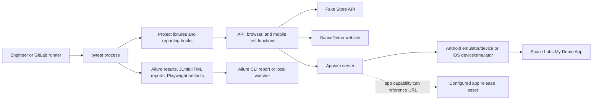
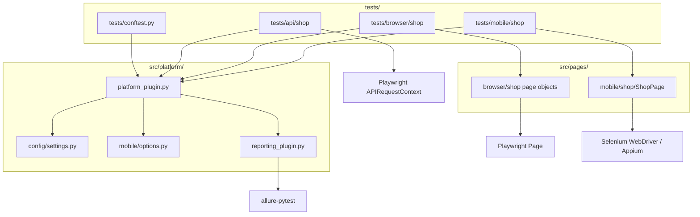
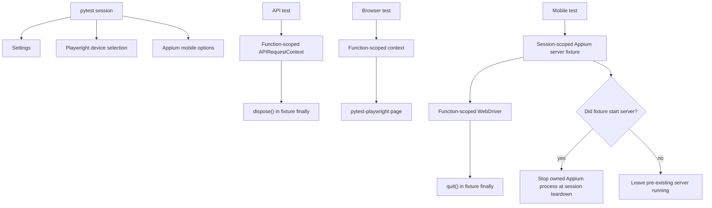
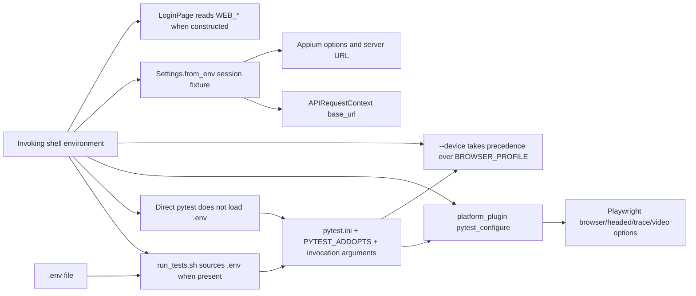
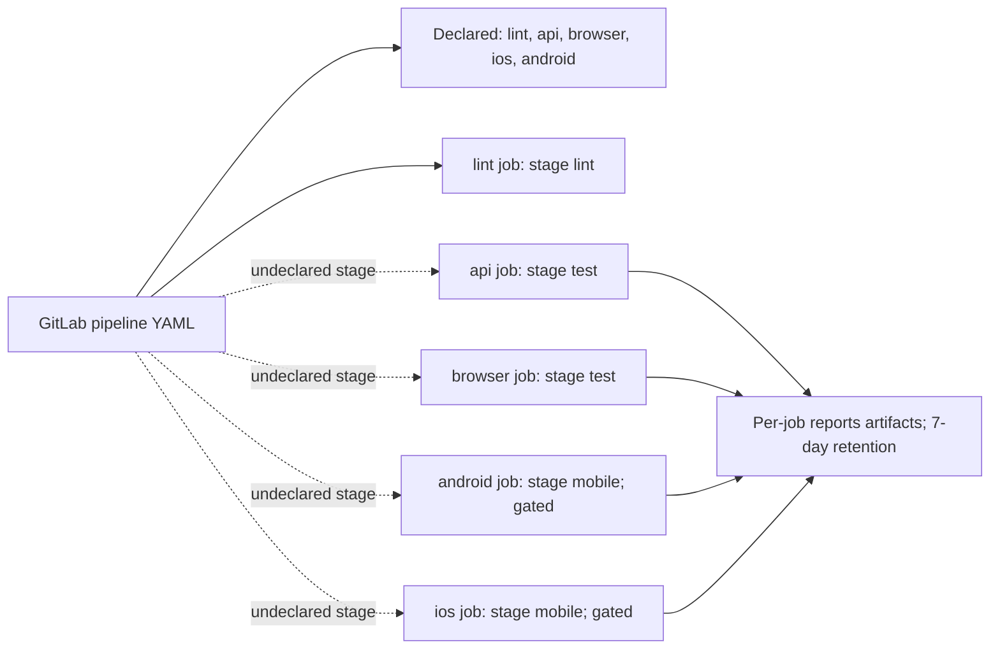
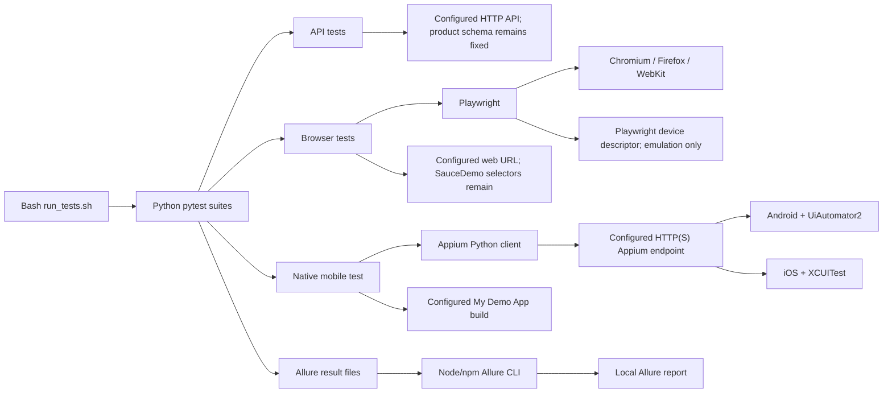
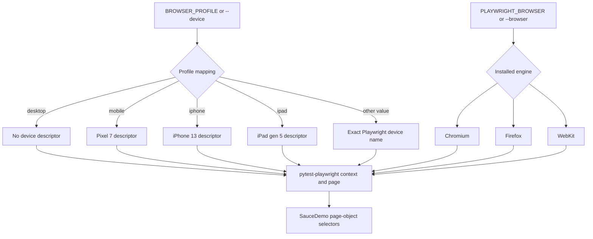
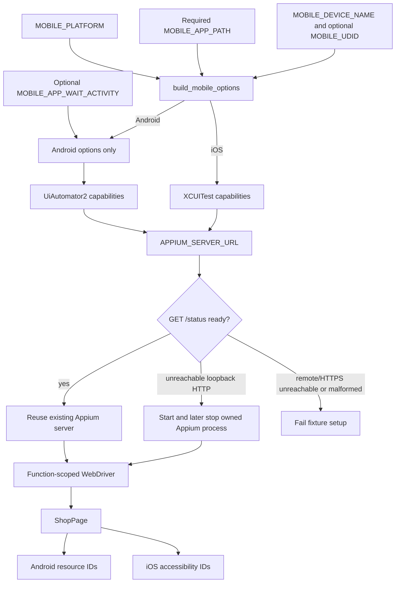
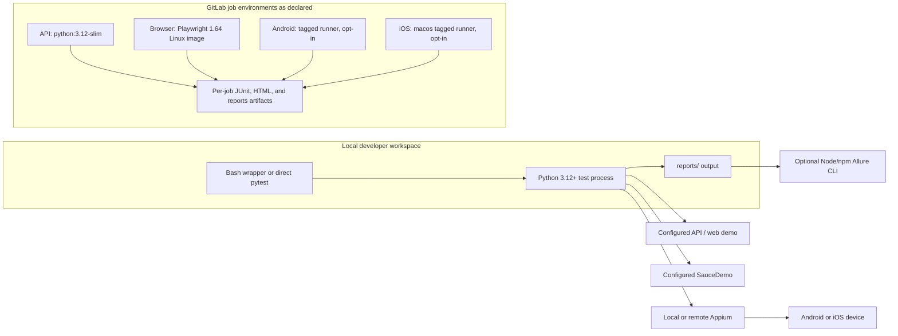

# QA Automation Platform — Technical Guide

This document is the implementation-aligned guide to the repository. It covers the checked-in pytest framework, its sample API/browser/mobile suites, local configuration, reporting, and the GitLab pipeline definition.

**Scope:** the current repository tree on 2026-10-20. The platform is a test harness, not a deployed service. Statements about code are linked to their source. Items described as recommendations or potential extensions are not implemented behavior.

## Contents

- [1. System overview](#1-system-overview)
- [2. Software architecture](#2-software-architecture)
- [3. Execution lifecycle](#3-execution-lifecycle)
- [4. Repository and module reference](#4-repository-and-module-reference)
- [5. Installation and environment setup](#5-installation-and-environment-setup)
- [6. Configuration reference](#6-configuration-reference)
- [7. Test development guide](#7-test-development-guide)
- [8. Integrations and CI/CD](#8-integrations-and-cicd)
- [9. Logging, reporting, and troubleshooting](#9-logging-reporting-and-troubleshooting)
- [10. Security and reliability](#10-security-and-reliability)
- [11. Extension and maintenance](#11-extension-and-maintenance)
- [12. Architecture decisions and limitations](#12-architecture-decisions-and-limitations)
- [13. Portability and execution topologies](#13-portability-and-execution-topologies)

## 1. System overview

### Purpose and scope

The repository provides one pytest entry point for three kinds of example checks:

1. **API:** Playwright's synchronous `APIRequestContext` calls Fake Store API and checks product fields.
2. **Browser:** Playwright drives the SauceDemo shop through page objects.
3. **Native mobile:** Appium drives Sauce Labs My Demo App on Android or iOS through Selenium's `WebDriver` API and platform-specific locators.

The framework supplies shared pytest fixtures, environment-backed settings, Appium server lifecycle management, browser recording options, and Allure metadata and failure screenshots. The tests themselves define the product behavior under check. See [the sample suites](../tests/) and [shared pytest plugin](../src/platform/platform_plugin.py).

This repository does **not** contain an application under test, a test-management service, a database, a distributed test coordinator, or an always-on automation service. Playwright, Appium, pytest, Allure, the browser/device, and the remote demo applications own those responsibilities.

### Terminology

- **Test case ID:** the value on `@pytest.mark.test_case(id="TEST-…")`; the reporting plugin copies it into the Allure ID and tags.
- **Profile:** a Playwright device descriptor selected through `BROWSER_PROFILE` or pytest's `--device` option. This is browser emulation, not an Appium device.
- **Mobile platform:** the Appium target selected by `MOBILE_PLATFORM` (`Android` or `iOS`).
- **Allure results:** raw per-test result and attachment files written by `allure-pytest`; an HTML report is a separate Allure CLI operation.
- **Run tag:** the first positional argument to `run_tests.sh`. A value such as `TEST-04` selects the matching case marker; `all` selects no case ID by itself.

### System context



The mobile test code selects Android or iOS locators, but the repository does not provision a device or guarantee the external applications are available. API and browser tests also depend on live external demo systems unless their endpoint variables are redirected.

## 2. Software architecture

### Architectural style

This is a small pytest plugin plus test suites and page objects:

- `tests/conftest.py` registers `platform_plugin`.
- `platform_plugin` registers `reporting_plugin` and provides shared fixtures/configuration.
- API tests call the fixture directly. Browser and mobile tests use page objects under `src/pages/<platform>/<domain>/`.
- Third-party pytest plugins own browser, page, tracing, video, and base pytest lifecycle behavior. The project overrides the Playwright `context` and `device` fixtures and adds its own API and Appium fixtures.

There is no application/service layer between the tests and their external targets, no repository or adapter interface for the API, and no independent configuration package. Imports are made available to pytest by `pythonpath = src src/platform` in [pytest.ini](../pytest.ini); the code is not configured as an installable Python package.

### Components and dependencies



Dependency direction is simple and test-oriented: tests depend on shared fixtures and (for UI) page objects; page objects depend on the browser or driver API. The plugin depends on pytest, Playwright, Appium, Selenium, and the Settings/mobile-options modules. Target URLs and app paths are configurable, but there is no adapter interface for substituting a different application's API or UI contract.

### Main boundaries and failure propagation

- Invalid supported environment values and mobile setup problems are raised as pytest `UsageError` before or during fixture setup.
- API, browser, and device errors otherwise propagate through pytest and make the test fail.
- The reporting hook tries to capture a screenshot for a failed setup or call when a browser page or mobile driver exists. A screenshot failure is attached as diagnostic text and does not replace the original failure.
- Fixture teardown disposes the API context, closes the mobile driver, and stops an Appium process only when the fixture started it.

No historical design rationale or ADR is present in the repository. Section 12 separates observed choices from inferred rationale.

## 3. Execution lifecycle

### Invocation paths

The main entry points are:

- Direct pytest, for example `python -m pytest tests/api/shop -m api`.
- [`run_tests.sh`](../run_tests.sh), which optionally sources `.env`, selects Python, converts a case tag and supplied marker filters into pytest arguments, and routes Allure output to `reports/<tag>/allure-results`.
- The npm scripts in [package.json](../package.json), which wrap the Allure CLI for running, generating, opening, and watching reports.

Direct pytest does **not** load `.env`. Environment variables must already be exported unless the shell wrapper is used.

### End-to-end lifecycle

```mermaid
sequenceDiagram
  actor User as Engineer or CI
  participant Script as run_tests.sh (optional)
  participant Pytest as pytest and pluggy
  participant Plugin as platform_plugin
  participant Report as reporting_plugin
  participant Test as selected test
  participant Target as API, browser, or Appium/device
  participant Output as reports/

  alt via run_tests.sh
    User->>Script: tag and pytest options
    Script->>Script: source .env if present; build marker/output args
    Script->>Pytest: python -m pytest
  else direct pytest
    User->>Pytest: invoke with exported environment
  end
  Pytest->>Plugin: load tests/conftest.py and configure plugins
  Pytest->>Report: register reporting hooks and autouse fixtures
  Pytest->>Test: discover and select tests by path, marker, -k, or case ID
  Report->>Output: write environment.properties when Allure is enabled
  Test->>Plugin: request only the needed fixtures
  Plugin->>Target: create request context, browser context, or Appium session
  Test->>Target: perform calls and assertions
  Pytest->>Report: report setup/call outcome
  Report->>Output: attach page/device screenshot on failure when available
  Plugin->>Target: dispose context, quit driver, stop owned Appium process
  Pytest->>Output: preserve result files and return pytest status
```

The wrapper combines `run_tests.sh <case-id> -m <marker>` into a marker expression that requires both conditions. With `all`, the wrapper adds no case-ID expression. An unmatched case ID normally results in pytest's no-tests-collected exit status. The wrapper preserves pytest's exit status because it uses `set -e`.

### Fixture/resource scopes

| Resource | Scope | Owner and cleanup |
| --- | --- | --- |
| `settings` | Session | Frozen `Settings` instance created once from process environment. |
| `device` | Session | Playwright device selection; explicit pytest `--device` wins over `BROWSER_PROFILE`. |
| `mobile_options` | Session | Appium capabilities; requires a mobile app path and supported platform. |
| `appium_server` | Session, only when mobile tests request it | Reuses a ready server; otherwise may start a local loopback HTTP server and stop only that child process at teardown. |
| `api_request_context` | Function | New Playwright API context per test; always disposed in fixture teardown. |
| `context` / `page` | Function (project context fixture plus pytest-playwright page fixture) | Browser context/page lifecycle is delegated to pytest-playwright. Project context optionally enables HAR recording. |
| `mobile_driver` | Function | New Appium WebDriver session per test; always calls `quit()` in teardown. |
| Page objects | Ordinary Python objects | Hold an existing Page/driver reference; they do not start or close the underlying resource. |



### Selection, synchronization, retry, and parallelism

Test discovery is pytest's `tests/` discovery, with marker selection and `-k` available. The registered markers are in [pytest.ini](../pytest.ini). The code uses pytest-playwright's waiting/assertion behavior in browser tests and explicit 10-second Selenium waits in `ShopPage`. The Appium status probe has a 2-second request timeout, and locally started Appium gets up to 30 seconds to become ready.

No retry plugin, retry policy, xdist worker configuration, distributed scheduler, or test-level concurrency control is configured. Parallel safety across separate pytest processes or devices is not established. API requests have no project-defined timeout or retry. Browser timeouts use pytest-playwright defaults.

## 4. Repository and module reference

### Meaningful repository tree

```text
.
├── .env.example
├── .gitlab-ci.yml
├── README.md
├── allurerc.json
├── allure.watch.mjs
├── package.json
├── package-lock.json
├── pyproject.toml
├── pyrightconfig.json
├── pytest.ini
├── requirements.txt
├── run_tests.sh
├── src/
│   ├── pages/
│   │   ├── browser/shop/
│   │   │   ├── cart_page.py
│   │   │   ├── inventory_page.py
│   │   │   └── login_page.py
│   │   └── mobile/shop/shop_page.py
│   └── platform/
│       ├── config/settings.py
│       ├── mobile/options.py
│       ├── platform_plugin.py
│       └── reporting_plugin.py
└── tests/
    ├── conftest.py
    ├── api/shop/test_products.py
    ├── browser/shop/test_cart.py
    └── mobile/shop/test_my_demo_app_cart.py
```

Generated output and local-only files are excluded: `.gitignore` ignores `.env`, virtual environments, `node_modules/`, `reports/`, caches, and Graphify output. The repository has no `docs/` or ADRs before this guide was added.

### Platform modules

- [`tests/conftest.py`](../tests/conftest.py): registers `platform_plugin`; it contains no additional fixtures.
- [`src/platform/platform_plugin.py`](../src/platform/platform_plugin.py): defines pytest configuration, browser device/context overrides, session settings and Appium capability fixtures, the API context, Appium status/startup/shutdown, and the per-test mobile driver.
- [`src/platform/config/settings.py`](../src/platform/config/settings.py): frozen, slotted `Settings` dataclass and `Settings.from_env()`. Reads API and mobile settings only; browser login settings are read directly by `LoginPage`.
- [`src/platform/mobile/options.py`](../src/platform/mobile/options.py): `build_mobile_options(settings)` returns `UiAutomator2Options` or `XCUITestOptions`; missing app path or unsupported platform raises `ValueError`.
- [`src/platform/reporting_plugin.py`](../src/platform/reporting_plugin.py): writes Allure environment metadata, maps case/platform markers into Allure labels, records successful page/driver fixtures for later screenshot capture, and attaches screenshots or screenshot-error text on setup/call failures.
- [`src/pages/browser/shop/login_page.py`](../src/pages/browser/shop/login_page.py): SauceDemo login URL/credentials and login controls; reads `WEB_BASE_URL`, `WEB_USERNAME`, and `WEB_PASSWORD` at object construction.
- [`src/pages/browser/shop/inventory_page.py`](../src/pages/browser/shop/inventory_page.py): inventory title, known add-to-cart selectors, and cart navigation.
- [`src/pages/browser/shop/cart_page.py`](../src/pages/browser/shop/cart_page.py): first cart item name locator.
- [`src/pages/mobile/shop/shop_page.py`](../src/pages/mobile/shop/shop_page.py): Android resource IDs, iOS accessibility IDs, cart interaction, visibility/click waits, and one-item assertion helper.

### Test suites and other configuration

- [`tests/api/shop/test_products.py`](../tests/api/shop/test_products.py): three parametrized GET checks with IDs TEST-01 through TEST-03.
- [`tests/browser/shop/test_cart.py`](../tests/browser/shop/test_cart.py): three parametrized SauceDemo cart flows with IDs TEST-04 through TEST-06.
- [`tests/mobile/shop/test_my_demo_app_cart.py`](../tests/mobile/shop/test_my_demo_app_cart.py): one My Demo App cart check with ID TEST-07.
- [`pytest.ini`](../pytest.ini): import paths, test root, default Allure/Playwright output and marker declarations.
- [`requirements.txt`](../requirements.txt): pinned Python dependencies.
- [`pyproject.toml`](../pyproject.toml): Ruff target version, lint rules, line length, and import sorting; it is not a Python package/build declaration.
- [`pyrightconfig.json`](../pyrightconfig.json): type-checker include and import paths; no pyright dependency or CI job is declared.
- [`.env.example`](../.env.example): example values, including public demo credentials and mobile app release URL.
- [`run_tests.sh`](../run_tests.sh): local test selector and report-directory wrapper.
- [`package.json`](../package.json), [`allurerc.json`](../allurerc.json), [`allure.watch.mjs`](../allure.watch.mjs): Allure command aliases, report inputs/output/history options, and live-watch output override.
- [`.gitlab-ci.yml`](../.gitlab-ci.yml): lint/API/browser/mobile job declarations; see the stage-name issue in [Section 8](#8-integrations-and-cicd).

There are no shared assertion helpers, test-data factories, database fixtures, logging module, or application adapters in the current tree.

## 5. Installation and environment setup

### Runtime and external requirements

- Python **3.12+** is the project-documented requirement; GitLab uses Python 3.12 images. The repository does not publish Python package metadata or an automated version check.
- `package.json` pins Allure CLI 3.21.0 but declares no Node.js engine constraint. Node.js/npm is needed to run that CLI. A locally installed Appium server also needs its Node.js/npm runtime; a runner that connects to a separately managed Appium server does not need to run Appium itself.
- API/browser execution needs network access to the configured target. Chromium must be installed for local browser tests. Firefox or WebKit must also be installed if selected.
- Mobile execution needs an Appium server, the matching Appium driver, an Android emulator/device or an iOS target, and the app build. A local app path must be visible to the Appium host; the code passes `MOBILE_APP_PATH` through as the Appium `app` capability. To auto-start a local server, the `appium` executable and its Node.js runtime must be on PATH. A remote Appium server owns those runtime requirements.
- iOS Appium execution requires macOS/Xcode on the Appium host, which may be remote from the pytest client. The repository does not create or boot simulators, provision signing, or attach hardware.
- npm and Node.js are needed for the bundled Allure CLI and for installing/running Appium locally. They are not needed for plain pytest runs against an already-running remote Appium server.

### Install

```sh
python3 -m venv .venv
source .venv/bin/activate
python -m pip install -r requirements.txt
python -m playwright install chromium
npm ci
```

Install another Playwright browser with `python -m playwright install firefox` or `webkit` when that engine is selected. The browser profiles `mobile`, `iphone`, and `ipad` are Playwright device emulation profiles, not real mobile-device runs.

### Configure

For the helper script, copy the example and edit it for the desired targets:

```sh
cp .env.example .env
```

`run_tests.sh` sources `.env` as shell syntax and exports the values before launching pytest. Direct pytest does not read this file; export variables in the invoking shell or use the wrapper. Keep real credentials out of the example and commit history.

### Run supported samples

```sh
# One case by Allure/pytest case ID
./run_tests.sh TEST-01

# Browser case with a visible browser
./run_tests.sh TEST-04 --headed

# API suite only
./run_tests.sh all -m api

# Browser suite only
./run_tests.sh all -m browser

# Mobile suite only; requires a configured app/device/Appium target
./run_tests.sh all -m mobile

# Run all collected suites
./run_tests.sh all

# Lint
python -m ruff check src tests
```

The helper writes tagged results to `reports/<lowercase-tag>/allure-results`; `all` writes to `reports/all/allure-results`. It accepts additional pytest arguments, combines repeated `-m`/ `--markexpr` filters with the case selector, and accepts `PYTHON` to choose the interpreter. Since the sample `.env.example` sets `PLAYWRIGHT_HEADED=on`, a local browser run may open a window; GitLab sets it to off.

The direct API command with isolated results is:

```sh
python -m pytest tests/api/shop -m api \
  --alluredir=reports/api/allure-results --clean-alluredir
```

Default `pytest.ini` arguments clear `reports/allure-results` at the beginning of a direct run. Use a dedicated `--alluredir` when preserving results from multiple runs for one report. `--clean-alluredir` clears the selected results directory.

### Mobile tools

The local setup uses Node.js/npm to install Appium and one driver per platform. Run the iOS driver on the macOS Appium host:

```sh
npm install --global appium
appium driver install uiautomator2  # Android
appium driver install xcuitest      # iOS
```

Start the Android AVD named by `MOBILE_DEVICE_NAME` before selecting mobile tests, unless targeting an already-connected device. The default sample app URL is configured in `.env.example`; `MOBILE_APP_PATH` may instead point to a local `.apk` or `.ipa` visible to the Appium host. For a remote Appium URL, the server must already be reachable and ready. A local auto-start is attempted only for an unreachable plain-HTTP loopback URL.

## 6. Configuration reference

### Configuration sources and precedence

There is no dotenv library or environment-selection abstraction. `run_tests.sh` optionally sources `.env`; all Python settings then read the process environment.

- Pytest's configured arguments are in `pytest.ini`. Standard pytest command-line options and `PYTEST_ADDOPTS` are also accepted.
- In `pytest_configure`, `PLAYWRIGHT_BROWSER`, `PLAYWRIGHT_HEADED`, `PLAYWRIGHT_TRACING`, and `PLAYWRIGHT_VIDEO` are applied only when the combined pytest arguments do not already contain that option. Accepted environment values are validated there.
- The explicit pytest `--device` option takes precedence over `BROWSER_PROFILE`.
- `Settings.from_env()` reads API/mobile values once per pytest session. Web login values are read by `LoginPage` when instantiated.
- Do not infer a universal order for every plugin option: pytest-playwright and Allure own their own option parsing.



### Environment variables

“Code default” means the fallback in the Python implementation. “Example” means the sample in `.env.example`; they can differ.

| Name | Code default / example | Accepted values and behavior |
| --- | --- | --- |
| `API_BASE_URL` | Code: `https://fakestoreapi.com`; example: same | Playwright API request base URL. No project URL validation or authentication is added. |
| `WEB_BASE_URL` | Code: `https://www.saucedemo.com`; example: same | Browser login page URL. |
| `WEB_USERNAME` | Code: `standard_user`; example: same | Browser demo account username. Read directly by `LoginPage`. |
| `WEB_PASSWORD` | Code: `secret_sauce`; example: same | Browser demo account password. Read directly by `LoginPage`. |
| `BROWSER_PROFILE` | Code: `desktop`; example: `desktop` | `desktop`, `mobile` (Pixel 7), `iphone` (iPhone 13), `ipad` (iPad gen 5), or exact Playwright device name. Unknown names raise `pytest.UsageError`. |
| `PLAYWRIGHT_BROWSER` | Example: `chromium`; otherwise pytest-playwright default | `chromium`, `firefox`, or `webkit`; project hook validates only when it supplies the environment default. |
| `PLAYWRIGHT_HEADED` | Example: `on`; GitLab: `off` | `on` or `off`. The project hook maps this to pytest-playwright's headed option. |
| `PLAYWRIGHT_TRACING` | Example: `retain-on-failure`; GitLab: `on` | `on`, `off`, or `retain-on-failure`. Passed through as pytest-playwright's tracing option. |
| `PLAYWRIGHT_VIDEO` | Example: `retain-on-failure`; GitLab: `on` | `on`, `off`, or `retain-on-failure`. Passed through as pytest-playwright's video option. |
| `PLAYWRIGHT_HAR` | Code: `off`; example: `off`; GitLab: `on` | `on` or `off`; project context fixture validates when used. On records one HAR per test. |
| `PLAYWRIGHT_HAR_DIR` | Code: `reports/playwright/har`; example: same; GitLab: same | Relative or absolute output path; parent directory is created when HAR is enabled. |
| `APPIUM_SERVER_URL` | Code: `http://127.0.0.1:4723`; example: same | HTTP(S) URL with host and valid port. A ready server is reused. An unreachable loopback HTTP endpoint may be started locally; unreachable remote/HTTPS endpoints must be started externally. |
| `MOBILE_PLATFORM` | Code: `Android`; example: `Android`; GitLab jobs set Android/iOS | Case-insensitive `Android` or `iOS`; other values fail mobile option setup. |
| `MOBILE_DEVICE_NAME` | Code: `Android Emulator`; example: `Pixel_8_Pro_API_35` | Appium device name; must correspond to the target available to Appium. |
| `MOBILE_UDID` | Code: unset; example: unset | Optional device UDID. Added to Appium capabilities when nonempty. |
| `MOBILE_APP_PATH` | Code: unset; example: Sauce Labs Android APK URL; CI sets a platform URL | Required when mobile options are created. A local path must be visible to the Appium host; a URL must be retrievable by it. Passed through as the Appium `app` capability. |
| `MOBILE_APP_WAIT_ACTIVITY` | Code: unset; example: Android MainActivity | Optional Android `appWaitActivity` capability. Not used for iOS. |
| `PYTEST_ADDOPTS` | Unset | Standard pytest additional arguments; read by pytest and considered by the project browser-option default logic. |
| `PYTHON` | Unset | Optional interpreter override for `run_tests.sh`; otherwise it prefers `.venv/bin/python`, then `python`, then `python3`. |

The browser profile only configures emulation in Playwright. It does not choose `MOBILE_PLATFORM`, boot a simulator, or provision Appium.

### Defaults and validation limits

- The sample configuration is not the same as all implementation defaults: notably, the code default mobile device name is `Android Emulator`, whereas the sample uses `Pixel_8_Pro_API_35`.
- Missing `MOBILE_APP_PATH`, invalid mobile platform, malformed Appium URL, invalid Appium port, and unsupported browser profile are surfaced as pytest usage/setup errors.
- `API_BASE_URL`, `WEB_BASE_URL`, web credentials, device availability, and URL safety are not validated by a centralized settings validator.
- Appium credentials/authentication are not represented in settings. Use a trusted server endpoint and secure its access outside this repository.

## 7. Test development guide

### Organization and naming

Place new suites under `tests/<platform>/<domain>/`; place browser/mobile screen actions in matching `src/pages/<platform>/<domain>/` modules. Use pytest classes/functions as the current samples do. Tests are marked by platform and domain (for example `api`, `browser`, `mobile`, `shop`, `regression`) and carry a case marker when they need an Allure case ID.

The current case IDs are TEST-01–TEST-07. IDs are a team convention: the plugin copies a supplied ID into Allure but the framework has no uniqueness check or required-ID enforcement.

### API pattern

This mirrors the implemented API case in [`test_products.py`](../tests/api/shop/test_products.py); use a new unique ID when adding a test.

```python
import pytest
from playwright.sync_api import APIRequestContext


@pytest.mark.api
@pytest.mark.shop
@pytest.mark.regression
@pytest.mark.test_case(id="TEST-08")
def test_product_is_returned(api_request_context: APIRequestContext) -> None:
    response = api_request_context.get("/products/1")
    assert response.status == 200
    product = response.json()
    assert product["id"] == 1
    assert product["title"]
```

The fixture sets `base_url` from `API_BASE_URL` and sends `Accept: application/json`. It does not add authentication, retries, or response-schema validation.

### Browser pattern

The existing [cart suite](../tests/browser/shop/test_cart.py) obtains pytest-playwright's `page`, constructs `LoginPage(page)`, logs in, then uses `InventoryPage` and `CartPage`. Keep locators and UI actions in the page object; keep scenario intent and assertions in the test. Playwright's `expect` assertions provide the waiting behavior used in the sample.

### Mobile pattern

The existing [mobile test](../tests/mobile/shop/test_my_demo_app_cart.py) receives `mobile_driver` and `settings`, creates `ShopPage(driver, settings.mobile_platform)`, performs the cart flow, and asserts one item. Keep Android resource IDs and iOS accessibility IDs in `ShopPage`. Its waits are 10 seconds; it waits for visible/clickable controls instead of fixed sleeps.

### Isolation, data, and cleanup

- API contexts and Appium driver sessions are function-scoped and closed by their fixtures.
- Browser page/context lifecycle is provided by pytest-playwright; the project creates a fresh context for a test and can enable per-test HAR recording.
- The samples use external public demo services. The API test is read-only; browser/mobile tests change a demo cart.
- The repository has no data factory, database fixture, explicit backend reset, or cleanup step for remote test data. Keep new tests on disposable test accounts/data and add cleanup if a target stores state.
- Parametrization is used for API and browser cases; no custom parameterization helper exists.
- `smoke` is registered but no current test uses it. New markers should be declared in `pytest.ini`.

No generic HTTP client, reusable assertion library, custom retry helper, or platform interface is currently provided. Recommendations to add one should be driven by repeated needs rather than assumed framework capabilities.

## 8. Integrations and CI/CD

### Implemented integrations

| Integration | Current use |
| --- | --- |
| pytest 9.1.1 | Discovery, markers, fixtures, hooks, assertions, exit status. |
| pytest-playwright 0.10.0 / Playwright 1.64.0 | Browser `Page`, browser context, API request context, device descriptors, tracing/video options. |
| Appium Python Client 6.0.7 / Selenium WebDriver | Native Android/iOS app sessions and element waits. |
| Allure pytest 2.16.2 | Raw results, labels, parameters, steps, attachments, environment metadata. |
| pytest-html 4.2.0 | CI HTML reports via explicit pytest arguments. |
| Fake Store API, SauceDemo, My Demo App release assets | External sample targets; no mocks or local copies are part of the suites. |
| GitLab CI | YAML job declarations for lint, API, browser, Android, and iOS work. |

The version numbers above come from [requirements.txt](../requirements.txt), [package.json](../package.json), and the checked-in CI image. No database, container, cloud-device grid, test-management API, or Slack/Jira integration is implemented.

### CI job intent and current configuration issue

The checked-in [`.gitlab-ci.yml`](../.gitlab-ci.yml) declares:

- Python 3.12 Ruff lint job.
- API job using `python:3.12-slim`, JUnit/HTML reports, and reports artifacts.
- Browser job using a Playwright 1.64 image, JUnit/HTML reports, and Playwright artifacts.
- Android/iOS jobs with runner tags `android` and `macos`; both are gated by `RUN_ANDROID=true` or `RUN_IOS=true`. They request app builds through release URLs.

The mobile jobs install the Python requirements only. They do not install Node.js, Appium, UiAutomator2/XCUITest drivers, Android SDK, Xcode, or provision a device. Their tagged runner hosts must already provide the matching service, driver, and device environment.

However, the declared stages are `lint`, `api`, `browser`, `ios`, and `android`, while API/browser jobs specify `stage: test` and Android/iOS specify `stage: mobile`. Those two stage names are absent from the declared list. GitLab normally rejects jobs whose stage is not declared; the pipeline has not been validated against a GitLab instance here. Treat successful CI execution as **unverified until this mismatch is resolved or confirmed by CI configuration validation**.

There is no Allure generation/aggregation job in the checked-in pipeline. CI artifacts are configured to expire after 7 days. If stage configuration is corrected, each job is configured to produce and publish its own result artifacts; the repository does not currently combine them into one downloadable Allure HTML report in CI. The `allurerc.json` history settings are local Allure CLI configuration, not a CI cache/serialization implementation.



There is no configured parallel worker count. GitLab jobs are separate jobs by declaration, but current stage validation prevents assuming their execution order or successful scheduling.

## 9. Logging, reporting, and troubleshooting

### Outputs

- **Allure results:** direct pytest defaults to `reports/allure-results/`; `run_tests.sh <tag>` writes `reports/<tag>/allure-results/`.
- **Playwright output:** pytest.ini defaults to `reports/playwright`; traces/videos follow pytest-playwright options. The example enables retain-on-failure for both. GitLab turns both on and also enables HAR.
- **HAR:** when `PLAYWRIGHT_HAR=on`, project context fixture writes one file per test under `PLAYWRIGHT_HAR_DIR`. The file name includes a sanitized test name and a short SHA-1 suffix derived from the pytest node ID.
- **Appium log:** when the fixture starts a local server, it redirects output to `reports/appium.log` (opened in write mode for that start).
- **Allure environment:** with an Allure output directory, a session fixture writes Python, OS, pytest, Playwright, and Appium client versions to `environment.properties`.
- **Failure screenshot:** browser/mobile screenshots are attached for setup/call failures if the corresponding page/driver is available. Capture is time-bounded; a failed capture adds a text attachment containing the exception type.
- **CI HTML/JUnit:** test jobs request self-contained pytest-html files and JUnit XML; artifacts use `when: always`.

The project does not configure a separate application logger, log redaction, or log aggregation. Pytest output is the normal test-runner output. Allure test steps and the API sample's status-only attachment are explicit in test code.

### Failure and reporting path

```mermaid
sequenceDiagram
  participant Pytest
  participant Fixture as Project fixture
  participant Hook as reporting_plugin
  participant Allure
  participant CI as Caller or CI

  Fixture->>Pytest: setup error, or test returns/raises
  Pytest->>Hook: setup/call report
  alt failed and Allure output enabled
    alt page or driver is available
      Hook->>Hook: attempt screenshot with bounded timeout
      alt screenshot succeeds
        Hook->>Allure: attach PNG
      else screenshot fails
        Hook->>Allure: attach error type as text
      end
    else no page or driver
      Hook->>Hook: skip screenshot
    end
    Pytest->>Allure: record failed test result
  else passed or teardown phase
    Pytest->>Allure: retain normal result; clear resource references at teardown
  end
  Pytest->>CI: return pytest exit status
```

### Allure commands

The CLI and report configuration are in [package.json](../package.json) and [allurerc.json](../allurerc.json):

```sh
# Run one tagged case through the Allure CLI wrapper
npm run test:report -- TEST-04

# Generate from configured result directories
npm run report

# Open the generated report on loopback
npm run report:open

# Watch result directories while running tests in another terminal
npm run report:watch
```

The static report target is `reports/allure-report`; the watcher overrides its output to `reports/allure-live` and binds to `127.0.0.1`. Allure configuration requests a single-file report and history path `reports/allure-history.jsonl` with a limit of 30. No CI job currently runs these report commands.

### Troubleshooting

| Symptom | Check |
| --- | --- |
| Pytest says no tests were collected for a tag | Confirm the case ID has a `test_case` marker and the correct case spelling. Use `python -m pytest --collect-only -q` to inspect discovery. A misspelled tag is a no-tests outcome. |
| Browser setting fails before tests | Check the allowed browser/trace/video values; the plugin validates an environment default when no pytest option overrides it. |
| Browser launches visibly or fails on a headless runner | Check whether `.env` was sourced and the value of `PLAYWRIGHT_HEADED`; GitLab sets it to `off`. |
| Browser executable missing | Install the selected engine with `python -m playwright install <chromium|firefox|webkit>`. |
| HAR option fails | `PLAYWRIGHT_HAR` accepts only `on` or `off`; check the output directory is writable. |
| API test cannot connect | Verify `API_BASE_URL`, DNS/network access, and target availability. No retry is added by the framework. |
| Mobile setup says app path missing | Set `MOBILE_APP_PATH`; code default is unset even though the example file supplies an APK URL. |
| Appium unreachable | For local auto-start, ensure plain HTTP loopback URL, Appium executable on PATH, correct port, and installed platform driver. For remote Appium, start/secure it separately and verify `/status`. |
| Appium startup exits or times out | Inspect `reports/appium.log`; the fixture reports premature exit, malformed status, or a 30-second startup timeout. |
| Mobile test cannot find controls | Confirm app version/platform matches the locators in `ShopPage`, and device/session is using the expected app build. |
| Prior Allure results disappear | Check `--alluredir` and `--clean-alluredir`; pytest.ini clears its default result directory, and the wrapper clears the selected tag directory. |
| CI configuration is rejected | Compare job `stage` values with the top-level `stages` list; current file uses undeclared `test` and `mobile`. |

## 10. Security and reliability

### Verified controls and behavior

- `.env` and `reports/` are ignored by Git. `.env.example` contains public demo credentials and public app URLs, not a production credential set.
- The Appium fixture validates HTTP(S), host, and port syntax. It only starts an unencrypted server itself when the configured host is loopback and the scheme is HTTP. An existing ready server is reused; it does not terminate a server it did not start.
- The API sample performs GET requests and attaches only the request path and HTTP status to its explicit summary attachment.
- Browser and mobile resources are closed in fixture teardown; API context is disposed and WebDriver quits.
- Screenshot capture errors do not mask the test failure.
- Reports and Playwright artifacts are ignored locally, and GitLab artifact expiry is set to seven days.

### Risks and limits

- No secrets manager, credential redaction, artifact access policy, or data classification is implemented here. `.env` being ignored prevents normal accidental commits but does not secure the file or CI variables.
- HAR, traces, videos, screenshots, pytest output, HTML/JUnit reports, and Appium logs may contain page content, URLs, headers, cookies, or test data. The code does not redact these artifacts. Use only demo/disposable accounts and restrict artifact access/retention.
- `WEB_BASE_URL` is configurable while sample credentials have defaults; pointing the tests at an unintended site could submit those values there. Keep the target and credentials aligned.
- `API_BASE_URL` can target any endpoint and is not allow-listed. The current sample only reads products, but future tests could mutate a target.
- Remote Appium access control and TLS/authentication are external to this repository. A reachable Appium server can control its device; expose it only to trusted runners.
- No retry policy, flake quarantine, xdist isolation, device lock, or global test-data reset exists. Simultaneous independent runs may contend for one Appium device or shared remote test account.
- Dependency versions are pinned, but this guide does not include a vulnerability scan or supply-chain audit.

These observations are not a certification or a complete security assessment.

## 11. Extension and maintenance

### Add a test

1. Put the test in the matching `tests/<platform>/<domain>/` folder.
2. Reuse the provided fixture: `api_request_context`, pytest-playwright's `page`, or `mobile_driver` plus `settings`.
3. Apply the platform/domain markers and a new `@pytest.mark.test_case(id="…")` if an Allure case ID is needed.
4. For a browser/mobile flow, add or extend the page object in `src/pages/<platform>/<domain>/`; keep driver/page ownership in fixtures.
5. Declare any new custom marker in `pytest.ini`.
6. Run the focused suite and lint. For live targets, use disposable accounts and a suitable device.

There is no marker-to-directory convention enforced by pytest beyond the current marker declarations, and no automated ID uniqueness check.

### Add configuration

- For API/mobile values, extend the frozen `Settings` dataclass and `from_env()` in [`settings.py`](../src/platform/config/settings.py), then consume it through the session `settings` fixture.
- For browser login settings, follow the current direct environment reads in `LoginPage` or deliberately centralize them only if the shared configuration boundary is being changed coherently.
- If adding a Playwright environment default, extend the allowlist/mapping in `pytest_configure` and document CLI/environment interaction.
- Update `.env.example`, this guide, and relevant CI variables. Do not put secrets in the example file.

### Add a mobile platform capability or reporting behavior

- Add capabilities in `build_mobile_options()`, keeping Android and iOS options explicit.
- Keep platform locators/waits in `ShopPage` or a domain page object; the driver remains fixture-owned.
- Allure labels/attachments belong in `reporting_plugin.py` or the test's own `allure.step` calls. Preserve the current failure path so diagnostics do not mask the original test error.

### Dependencies and compatibility

- Python dependencies are exact-pinned in `requirements.txt`; Allure CLI is pinned through `package.json` and `package-lock.json`.
- After changing Playwright versions, align the browser image in GitLab and reinstall matching browser binaries. After changing Appium/client versions, validate both platform option classes and driver APIs.
- The repository workflow has no contributor guide, release process, or automated version matrix. Validate against actual local/CI environments before claiming support for new versions or devices.

### Suggested local proof

```sh
python -m ruff check src tests
python -m pytest --collect-only -q
python -m pytest tests/api/shop -m api --alluredir=reports/api/allure-results --clean-alluredir
```

The collection and lint commands do not contact the demo applications. The API command does contact the configured API service. Browser/mobile end-to-end checks require their external targets and, for mobile, Appium plus a device.

## 12. Architecture decisions and limitations

### Observable decisions

| Observed choice | Evidence | Trade-off / rationale status |
| --- | --- | --- |
| pytest fixtures and hooks are the composition point | `tests/conftest.py`, `platform_plugin.py`, `reporting_plugin.py` | Uses native pytest lifecycle and keeps runtime setup local; the repository does not record the original rationale. |
| Page objects are grouped by platform and domain | `src/pages/browser/shop/`, `src/pages/mobile/shop/` | Separates selectors/actions from scenario assertions, but does not abstract a common cross-platform behavior contract. |
| Playwright serves both API and browser testing | API fixture and browser fixtures both import from Playwright | One pinned browser/network library; API tests are coupled to Playwright's sync request API. |
| Appium server ownership is conditional | `appium_server` reuses ready services and cleans up only its own child | Supports local convenience and prestarted remote endpoints; external remote-service lifecycle is caller-owned. |
| Allure result generation is separate from pytest collection | pytest writes raw results; npm scripts invoke CLI | Allows report generation after tests, but checked-in GitLab YAML does not currently aggregate results. |
| Environment is read directly from process variables | `Settings.from_env()`, `LoginPage`, pytest plugin | Minimal dependencies; defaults/validation are split across modules and direct pytest needs exported environment. |

These are implementation facts; they should not be read as recorded developer intent.

### Confirmed limitations and open work

1. **GitLab stage mismatch:** configured job stages do not exist in the declared `stages` list. Validate/fix before treating CI as operational.
2. **No CI Allure aggregation:** no job runs the Allure generator or publishes a consolidated report; current jobs publish their own artifacts.
3. **No reporting test suite:** the checked-in tree has no `tests/reporting/` files, although the previous root README referenced one. That reference has been corrected; reporting behavior is not covered by a committed dedicated test.
4. **No runtime matrix:** only pinned dependencies and current image declarations express versions; no compatibility matrix is tested.
5. **No retry/parallel coordination:** there are no configured retries, xdist workers, device locks, or remote test-data isolation.
6. **Configuration validation is uneven:** mobile and selected Playwright options have explicit validation; target URLs and web credentials do not.
7. **No formal ADRs:** the three available commit subjects (`Initial commit`, `Reporting added`, `CI fix`) do not document architectural rationale.
8. **External dependencies are live:** results can vary with demo service availability, external data, network, browser binaries, and device/app state.

### Discrepancies reconciled with the root README

The root README previously described a reporting test directory and dedicated CI reporting check that are absent from the tree, and claimed a final CI job generated a merged Allure report. Those claims were corrected to reflect the current YAML. Allure local history configuration remains documented as local CLI configuration; CI history persistence is not implemented in the current pipeline.

## 13. Portability and execution topologies

Portability is provided at a few explicit seams: pytest can select a browser engine/profile, Appium options switch between Android and iOS, and API/web/mobile endpoints can be configured. These seams do not make the sample scenarios application-agnostic: endpoints, JSON expectations, web selectors, and app accessibility IDs still target the named demo products.

### Portability map



### Supported selection and environmental limits

| Surface | Selection implemented in the repository | External/environment requirement | Portability status |
| --- | --- | --- | --- |
| API | `API_BASE_URL`; tests call `/products/<id>` and assert Fake Store product fields. | Python dependencies and network access to a compatible API. | URL is configurable; schema and assertions are still specific to the sample API. |
| Browser engine | `PLAYWRIGHT_BROWSER` or pytest-playwright browser options accept Chromium, Firefox, and WebKit. | Matching Playwright browser binaries on the runner. | Three engine names are supported by the configuration hook; the checked-in CI image is pinned to Playwright 1.64 and defaults to Chromium. |
| Browser profile | `BROWSER_PROFILE` maps desktop, Pixel 7, iPhone 13, and iPad gen 5 descriptors; other Playwright device names are accepted. Explicit `--device` takes priority. | Device descriptor exists in the installed Playwright version. | Browser viewport/device emulation only; it does not use Android/iOS hardware. |
| Android | `MOBILE_PLATFORM=Android` builds UiAutomator2 capabilities; the page object uses Android resource IDs. | Appium server, UiAutomator2 driver, Android SDK, and available emulator/device. | Code path exists; the repository does not install the driver or provision the device. |
| iOS | `MOBILE_PLATFORM=iOS` builds XCUITest capabilities; the page object uses iOS accessibility IDs. | Appium XCUITest driver and macOS/Xcode on the Appium host. A simulator build or a device-compatible IPA is required for the chosen target. | Code path exists. CI passes an IPA, so that CI target requires a physical device; the README's simulator example uses a simulator build. |
| Shell wrapper | `run_tests.sh` sources `.env`, selects Python, and builds pytest arguments. | Bash and Unix-like shell utilities. | The wrapper is not a native PowerShell script. Windows use through WSL/Git Bash is not verified. |
| Local Appium auto-start | The fixture starts only unreachable plain-HTTP loopback Appium and manages its process group. | Appium CLI plus its Node runtime; POSIX process-group support. | The process-management code uses POSIX process-group APIs, so local auto-start is not portable to Windows. A ready external server avoids that child-process path; Windows test execution remains unverified. |
| Reports | Python writes result/artifact paths under `reports/`; npm scripts invoke Allure. | Writable workspace; Node.js/npm for Allure CLI. | Output paths are relative to the test working directory. The wrapper changes to the repository root; direct commands should be run there for the documented paths. |

These are code/configuration capabilities, not a cross-platform certification. The API sample was executed in the current environment. Browser and mobile runtime combinations were not executed as part of this documentation pass.

### Browser engine and profile routing

Engine and profile are separate choices. The engine controls the browser implementation. The profile selects a Playwright descriptor that applies device emulation settings. The source-defined shortcut names map to descriptors; other values must match an entry in `playwright.devices`.



To target iPad Safari emulation, combine the iPad profile with WebKit and install the WebKit binary. That does not verify behavior on a physical iPad or installed Safari.

### Native mobile routing

The capability builder and the page object both branch on platform. Android alone receives the optional `MOBILE_APP_WAIT_ACTIVITY`; both platforms can receive a UDID. The server endpoint can be an already-running local or remote service. If it is unreachable, the fixture only attempts a child process for an HTTP loopback address.



The test runner does not call Android/iOS operating-system APIs directly: platform interaction goes through the Appium server and its installed driver. App reset semantics, device provisioning, and installation of platform tooling are not explicitly managed by this repository.

### Local and CI topology

The diagram shows the declared execution environments, not proof that the current GitLab pipeline runs. The `test`/`mobile` stage mismatch described in Section 8 must be addressed or validated first.



The Linux API/browser jobs install Python requirements in their images. The mobile job definitions install only Python requirements and set app/platform variables; they rely on runner-provided Appium, matching drivers, SDK/Xcode, and devices. The CI YAML does not define a unified artifact merge or a portability test matrix.

### Portability checklist when changing a target

1. **API:** update `API_BASE_URL` and verify the path, response fields, and prices asserted by `test_products.py`; changing the URL alone does not adapt the assertions.
2. **Browser:** update `WEB_BASE_URL` and matching credentials, then confirm the selectors in `LoginPage`, `InventoryPage`, and `CartPage`. Install the chosen browser engine in every runner image.
3. **Android:** provide an Android-compatible app build, Appium server, UiAutomator2 driver, and device; update resource IDs and optional launch activity where the app requires them.
4. **iOS:** provide a simulator build for Simulator or a device-compatible IPA for a physical device, install XCUITest, and supply a UDID when needed. Check accessibility IDs against the selected app build.
5. **Runner/shell:** preserve Python and pinned Playwright compatibility, ensure report directories are writable, and provide a ready remote Appium server or a POSIX host for local auto-start. Make local app files available on the Appium host.
6. **CI:** validate job stages and runner prerequisites in GitLab before relying on this pipeline. The checked-in YAML currently has undeclared job stages and no mobile tooling installation.

### Verification status

Repository structure, Python source, pytest configuration, package manifests, sample environment, helper script, and CI YAML were inspected. The documentation pass verified the Ruff check, collected seven pytest cases, and ran the three API cases successfully with `API_BASE_URL` explicitly configured. Local Markdown links and fenced blocks were checked. Browser and mobile runtime combinations were not run, the GitLab pipeline was not submitted for validation, and a Mermaid renderer was unavailable; diagram syntax was reviewed but not renderer-validated.
